<p align="center">
  
</p>

<p align="center">
  
</p>

Saya mahasiswa Sistem Informasi di Universitas Negeri Semarang dengan minat di software development, teknologi web, dan aplikasi berbasis AI. Saya suka mengubah ide menjadi solusi digital yang praktis, mulai dari web responsif dan desain antarmuka sampai sistem backend dan aplikasi cerdas.

### `$ ls ~/tech-stack`

**Languages**<br>


**Frontend**<br>


**Backend**<br>


**Database & Tools**<br>


**AI & Dev Tools**<br>


### `$ ls -la ~/projects`

```bash
drwxr-xr-x  codelines-landing-page   # Responsive company landing page (Next.js)
drwxr-xr-x  fira-ai                  # AI-powered personal financial intelligence & recommendation assistant
drwxr-xr-x  voltess                  # AI-powered energy management for small businesses
drwxr-xr-x  trading-signal-bot       # Python stock market analysis & trading signal system
drwxr-xr-x  umkm-inventory-pos       # Integrated inventory & point-of-sale system
```

### `$ ./stats.sh`
<p>
  
  
</p>

### `$ ./connect.sh`
<p>
  <a href="https://www.linkedin.com/in/dhifansa-pradibtya-rafi-a32531322/" target="_blank">
    
  </a>
  <a href="https://github.com/Dhifansa" target="_blank">
    
  </a>
  <a href="https://www.instagram.com/dhifansapradibya?igsh=b3M3bW1vNGtvM284&utm_source=qr" target="_blank">
    
  </a>
  <a href="https://www.tiktok.com/@sadapbij1?_r=1&_t=ZS-9BZRGiGVJFV" target="_blank">
    
  </a>
  <a href="https://dhifansa-pradibtya-rafi.vercel.app/" target="_blank">
    
  </a>
</p>

<p align="center"><i>"Building meaningful solutions through technology and continuous learning."</i></p>


